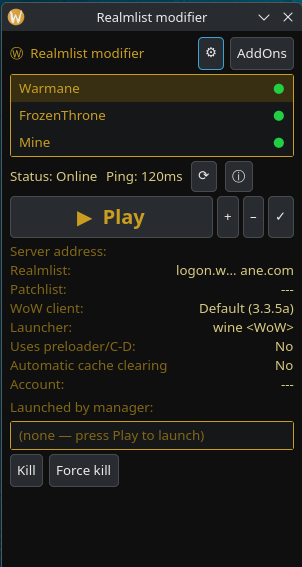
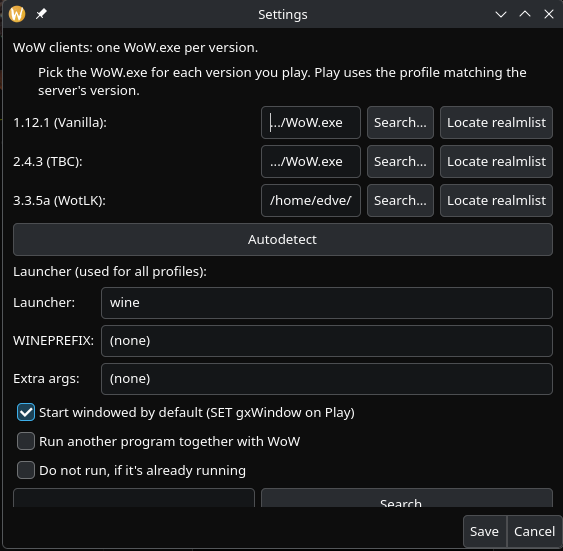
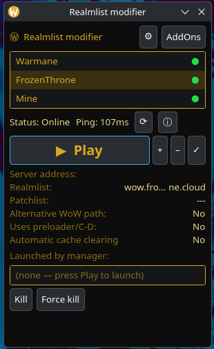

# WoW Realmlist Manager — v4.0.0

A Linux clone of the classic **"Realmlist modifier"** tool for World of Warcraft private servers. Switch `realmlist.wtf` between servers, check status, manage AddOns, and launch the client via Wine — without hand-editing config files.

## What's new in 4.0.0

- **Down to 3 profiles:** the `Forever` slot is removed — `1.12.1` / `2.4.3` / `3.3.5a` only. Existing configs migrate automatically (stale `Forever` keys are dropped, `Forever`-typed servers become `3.3.5a`).

## What's new in 3.0.0

- **Simplified to 3 fixed profiles:** `1.12.1` / `2.4.3` / `3.3.5a` — each holds exactly one `WoW.exe` path. No more free-form client list, no per-server overrides to get lost in. Adding 3.3.5a is now just Settings → paste the path → Save.
- **Play prompts when a profile is missing:** if you start a server whose version has no `WoW.exe` configured, the app offers to pick the file right there and saves it to that profile.
- **Default servers:** OctoWoW (`1.12.1`), FrozenThrone (`3.3.5a`), Warmane (`3.3.5a`).
- Old configs migrate automatically (legacy `clients` / `wow_exe` / per-server paths are folded into the matching profile slot).

## What's new in 2.1.0

- **Windowed-mode startup:** per-server `Start in windowed mode` checkbox (Additional settings) plus a global `Start windowed by default` fallback in ⚙ Settings. On Play, `SET gxWindow "1"` is written into the client's `WTF/Config.wtf` (created if missing); when off, your existing `gxWindow` value is left untouched.
- Details grid and ⓘ dialog show the resolved `Windowed: Yes/No` state.

## What's new in 2.0.0

- **Multi-client:** named WoW installs per version (`1.12.1` / `2.4.3` / `3.3.5a`) in ⚙ Settings; each server picks a client from a dropdown (auto-assigned by `server_type`).
- **Per-client launchers:** each client has its own launcher command, `WINEPREFIX` and extra args, with global defaults as fallback.
- **Per-client realmlist lookup:** `Locate realmlist` buttons in Settings and in Add/Edit server show exactly which `realmlist.wtf` file(s) Play will update.
- **Details grid** now shows the resolved `WoW client` and `Launcher` per server.






## Screenshot overview



What you're looking at, top to bottom:

| Area | What it does |
|---|---|
| Title bar `Ⓦ Realmlist modifier` + `⚙` / `AddOns` buttons | `⚙` opens global Settings (WoW.exe path, timeouts). `AddOns` opens the AddOns manager for the selected server's client. |
| Server list (gold box) | Your servers. The colored dot is the status: 🟢 online, 🔴 offline, ⚪ unknown/checking. Click to select, double-click (or ▶ Play) to launch. Drag rows to reorder. |
| `Status: Online / Ping: 107ms` + `⟳` / `ⓘ` | Result of the last TCP status check. `⟳` re-checks all servers, `ⓘ` shows the selected server's info (type, site, notes). |
| `▶ Play` + `+ – /` | `▶ Play` writes the realmlist and launches WoW. `+` adds, `–` removes, `✓` edits a server. |
| Details grid (`Server address`, `Realmlist`, `Patchlist`, `WoW client`, `Launcher`, `Windowed`, `Uses preloader`, `Automatic cache clearing`) | Shows the selected server's resolved config. |
| `Launched by manager` + `Kill` / `Force kill` | PIDs this app launched (detached, so they survive manager exit). `Kill` = SIGTERM, `Force kill` = SIGKILL. Dead PIDs are pruned automatically every 2 s. |

## Features

- Server list with online/offline dot (TCP connect to port 3724) + ping in ms
- One-click **Play**: writes every `realmlist.wtf`, patches `WTF/Config.wtf`, optionally clears `WDB`, launches via wine. If the server's version has no `WoW.exe` configured, Play asks you to pick it and saves it to that profile.
- 3 fixed profiles: one `WoW.exe` per version (`1.12.1` / `2.4.3` / `3.3.5a`) in Settings; each server picks a version, Play uses that profile's exe.
- Per-profile realmlist lookup: `Locate realmlist` in Settings shows exactly which `realmlist.wtf` file(s) Play will update
- Windowed-mode startup per server (`windowed`) with a global `default_windowed` fallback — writes `SET gxWindow "1"` on Play, never forces fullscreen
- Add / edit / remove servers: Basic tab (name, address, account, client version) + Additional tab (own patchlist, preloader, auto cache clear, windowed mode, RSS, site, info)
- Global Settings: 3 WoW profiles (one `WoW.exe` per version), launcher / `WINEPREFIX` / args, run-an-extra-program with WoW, connection timeout
- AddOns manager: enable/disable (`.disabled` rename), delete, install from `.zip` (zip-slip protected), open folder
- Instance tracker: detached `Popen(start_new_session=True)` launches, liveness via `poll()`/`/proc`, SIGTERM/SIGKILL buttons
- Drag-to-reorder server list, persisted to `servers.json`
- Zero third-party Python deps (stdlib + GTK4 **or** Tkinter)

## Requirements

- Linux + Python 3.10+
- **GTK app (default):** `python3-gi` + GTK4
  ```bash
  # Debian / Ubuntu
  sudo apt install python3-gi gir1.2-gtk-4.0 wine
  ```
- **Tk app (legacy fallback):** `python3-tk`
- `wine` to actually run `WoW.exe`, `xdg-open` for "Open folder", `pgrep` for extra-program detection

## Download (recommended)

Get the latest build from [GitHub Releases](https://github.com/nicthegarden/wow-manager/releases) — no Python setup needed:

| File | What it is |
|---|---|
| `WoWRealmlistManager-*-x86_64.AppImage` | Double-clickable app (recommended). `chmod +x` then run. |
| `wow-manager-*-x86_64` | Plain GTK binary, run from a terminal. |
| `wow-manager-tk-*-x86_64` | Legacy Tk fallback, fully self-contained. |

The GTK binary and AppImage need system GTK4 with introspection (present on virtually all modern desktops):
```bash
# Debian / Ubuntu (only if the app fails to start with a Gtk typelib error)
sudo apt install gir1.2-gtk-4.0
```
Plus `wine` to actually launch `WoW.exe`.

## Quick start (from source)

```bash
git clone https://github.com/nicthegarden/wow-manager.git
cd wow-manager

# GTK version (recommended)
./run.sh
# or: python3 realmlist_manager_gtk.py

# Tkinter version (legacy, no GTK needed)
python3 realmlist_manager.py
```

First run auto-creates `servers.json` next to the script with safe defaults. Then open **⚙ Settings** and point **Path to WoW.exe** at your client. To start from the shipped example:

```bash
cp servers.example.json servers.json
```

## Usage

1. **Settings:** set your 3 WoW profiles once — one `WoW.exe` per version (`1.12.1`, `2.4.3`, `3.3.5a`). Use `Locate realmlist` to verify which files a profile writes.
2. **Add server (+):** name + address (e.g. `logon.example.com`) + client version (picks the profile). Use the Additional tab for patchlist / preloader / windowed mode / auto cache clear.
3. **Select:** status, ping and the details grid update. `⟳` re-pings everything without blocking the UI.
4. **Play (▶):** writes configs (see below) and launches with Wine. Use **AddOns** beforehand to set up mods.
5. **Instances:** after Play, the PID appears under "Launched by manager". `Kill` / `Force kill` stops it.

## How it works

### Config (`servers.json`)

- Location: same folder as the script (`APP_DIR / "servers.json"`).
- Shape: `{"servers": [...], "settings": {"profiles": {"1.12.1": "...", "2.4.3": "...", "3.3.5a": "..."}, ...}}` — see `servers.example.json`.
- First run: built from `DEFAULT_SERVERS` + `DEFAULT_SETTINGS`; known install locations (`KNOWN_PROFILE_PATHS`) pre-fill empty profile slots, and a `WoW.exe` next to the script is picked up into the first empty slot. Legacy `clients` / `wow_exe` / per-server paths migrate into the matching profile.
- Every add/edit/delete/reorder calls `save_data()` (GTK) / `save_servers()` (Tk) immediately. The file is **git-ignored** — never commit your real one.
- Profile resolution: `effective_wow_exe(server, settings)` returns `settings.profiles[server.server_type]`. If it is missing on Play, the app asks you to pick the `WoW.exe` and saves it.
- Launcher resolution: `effective_launch(server, settings)` returns the global `default_launcher` / `default_wineprefix` / `default_args` (one launcher for all profiles).
- Windowed resolution: `effective_windowed(server, settings)` — per-server `windowed` OR global `default_windowed`.

### Status check (non-blocking)

- `ping_realm(host, port=3724)` strips `http(s)://`, paths and `:port`, resolves DNS, then `socket.create_connection()` with `settings.timeout_ms`. Returns `(True, ms)` or `(False, None)`.
- Runs in a daemon thread (`check_all()`); results are marshalled back with `GLib.idle_add` (GTK) / `after(0, ...)` (Tk) and repaint the dots + status/ping labels.

### Play: writing the realmlist

`write_realmlist(wow_exe, address, patchlist)`:

1. Resolve the client dir: parent of `WoW.exe` (or the dir itself if a folder was given).
2. Find **every** `realmlist.wtf` under it via case-insensitive `rglob` — covers 1.12 (`<wow>/realmlist.wtf`) and 2.x/3.x (`Data/<locale>/realmlist.wtf`) without hardcoding a layout. Falls back to `<wow>/realmlist.wtf` if none exist yet.
3. Write `set realmlist <address>` (+ `set patchlist ...` if the server has `own_patchlist`) into each file.
4. Patch `<wow>/WTF/Config.wtf` in place: replace existing `SET realmlist` / `SET patchlist` lines, append if missing, drop patchlist when the server doesn't use one. When windowed mode is on (`windowed` or `default_windowed`), force `SET gxWindow "1"` (created with the file if missing); otherwise an existing `gxWindow` line is left alone.
5. If `auto_clear`, delete all files under `<wow>/WDB` (cache).

### Play: launching

- Extra program first (if `run_extra` + `extra_path`; skipped when `extra_skip_if_running` and `pgrep` finds it).
- Then `subprocess.Popen(argv, cwd=<client dir>, start_new_session=True, stdio→DEVNULL)` where `argv = build_launch_cmd(target, launcher, args)` (launcher + extra args + exe, `shlex`-split) and `target` is the preloader exe when `uses_preloader`, else `WoW.exe`. `WINEPREFIX` is set in the child env only when configured. Detached on purpose: WoW **survives** manager exit.
- Each launch appends `{"pid", "proc", "server", "exe", "started"}` to `self.launched`; `refresh_instances()` (every 2 s) drops entries whose `proc.poll()` is not `None` (or `pid_alive()` via `os.kill(pid, 0)`), so the list never fills with zombies.

### AddOns manager

- Lists `<wow>/Interface/AddOns/*/`: folder name, `## Title:` / `## Version:` from the `.toc` (WoW `|c...|r` color codes stripped). Folders ending in `.disabled` show as disabled.
- **Disable/Enable** = rename with/without `.disabled`. **Delete** = `shutil.rmtree` after confirm. **Install from .zip** extracts with zip-slip protection (`resolve()` must stay under `AddOns/`). **Open folder** = `xdg-open`.

### Server fields

| Field | Meaning |
|---|---|
| `name` / `address` | Display name + realmlist host (`logon.example.com`). |
| `own_patchlist` / `patchlist` | When true, also writes `set patchlist`. |
| `uses_preloader` / `preloader` | Launch this exe instead of `WoW.exe` (custom loaders). |
| `server_type` | One of `1.12.1`, `2.4.3`, `3.3.5a` — picks which of the 3 profiles Play uses. |
| `windowed` | Start this server in windowed mode (`SET gxWindow "1"` on Play). |
| `auto_clear` | Clear `WDB` on every Play for this server. |
| `rss` / `site` / `info` | Shown in the ⓘ info dialog; `site` has a Visit button. |

| Setting | Meaning |
|---|---|
| `profiles` | The 3 fixed WoW installs: `{1.12.1, 2.4.3, 3.3.5a}` → `WoW.exe` path each. |
| `default_launcher` / `default_wineprefix` / `default_args` | Launcher command (`wine` by default), `WINEPREFIX` and extra args used for every profile. |
| `default_windowed` | Start windowed unless the server says otherwise. |
| `run_extra` / `extra_path` / `extra_skip_if_running` | Launch another program alongside WoW. |
| `timeout_ms` | Status-check TCP timeout (500–15000). |
| `save_window_pos` / `check_updates` | Parity options kept from the original tool. |

## Desktop integration

`wow-manager.desktop` runs `run.sh` from its own folder, so it works wherever you clone the repo:

```bash
cp wow-manager.desktop ~/.local/share/applications/
```

## Files

| File | What it is |
|---|---|
| `realmlist_manager_gtk.py` | Main app (GTK4, default via `run.sh`) |
| `realmlist_manager.py` | Legacy Tkinter version |
| `run.sh` | `cd $(dirname $0) && exec python3 realmlist_manager_gtk.py` |
| `servers.example.json` | Example config — copy to `servers.json` |
| `servers.json` | Your local config — auto-created, **git-ignored** |
| `wow-manager.desktop` | Desktop entry |
| `docs/screenshot.png` | Screenshot used above |

## Contributing

Issues and PRs welcome. Don't include personal server addresses, IPs, or local `WoW.exe` paths — use `logon.example.com` in examples.

## Disclaimer

Unofficial community tool, not affiliated with Blizzard Entertainment. World of Warcraft is a trademark of Blizzard Entertainment. Only connect to servers you have the right to use.
